<picture>
  <source media="(prefers-color-scheme: dark)" srcset="docs/images/hero-dark.png">
  
</picture>

<p align="center"><b>Your week with Claude Code, and your plan's limits, at the edge of your Mac's screen.</b></p>
<p align="center">A tide for each plan beside your Dock, a battery for each in the menu bar, the details a click away, and a calendar of your week that writes your weekly report.</p>

<p align="center">
  <a href="#get-started"></a>
  <a href="#build-from-source"></a>
  <a href="LICENSE"></a>
  <a href="https://github.com/wbuf81/tidemark/actions/workflows/ci.yml"></a>
  <a href="#cost"></a>
</p>

<p align="center"><b><a href="#what-it-does">What it does</a> · <a href="#see-it-move">See it move</a> · <a href="#how-it-works">How it works</a> · <a href="#get-started">Get started</a> · <a href="#questions">Questions</a> · <a href="#privacy">Privacy</a></b></p>

<p align="center"><a href="https://github.com/wbuf81/tidemark/releases/latest"><b>Download for Mac</b></a></p>

<p align="center"><sub>An independent app for people who use Claude Code. Not made by Anthropic.</sub></p>

## What it does

<table>
  <tr>
    <td width="50%" valign="top">
      <picture>
        <source media="(prefers-color-scheme: dark)" srcset="docs/images/feature-tide-dark.png">
        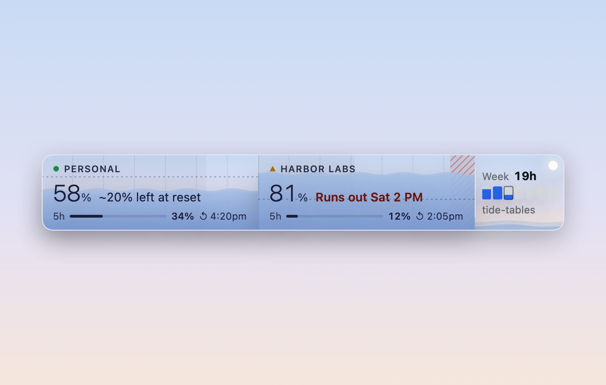
      </picture>
      <br><b>Each plan is a tide</b><br>
      Beside your Dock, each plan's week fills like a tide: the water rises as you use it, and the days you'd be locked out are hatched red. Right-click for <i>Water level</i> or <i>Over the week</i>.
    </td>
    <td width="50%" valign="top">
      <picture>
        <source media="(prefers-color-scheme: dark)" srcset="docs/images/feature-status-dark.png">
        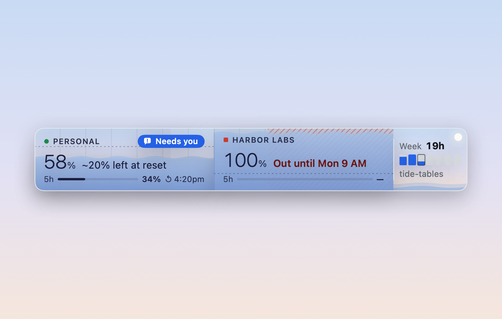
      </picture>
      <br><b>Claude Code, on the plan it's using</b><br>
      Thinking, working or waiting for you, shown on the plan Claude Code is signed in to. Only <i>Needs you</i> is in colour.
    </td>
  </tr>
  <tr>
    <td width="50%" valign="top">
      <picture>
        <source media="(prefers-color-scheme: dark)" srcset="docs/images/feature-battery-dark.png">
        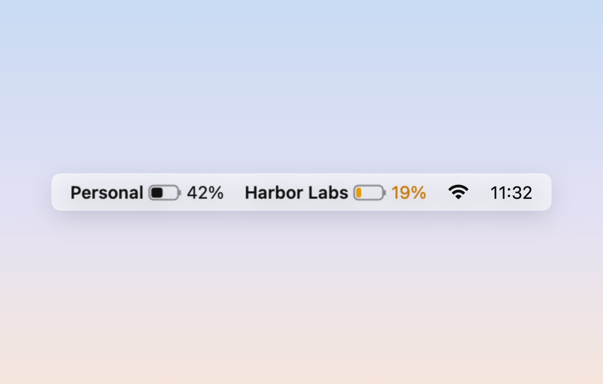
      </picture>
      <br><b>A battery in the menu bar</b><br>
      Each plan's week as a battery: full at the reset, draining as you go, amber when it will run out early, red and <i>Out</i> when it has.
    </td>
    <td width="50%" valign="top">
      <picture>
        <source media="(prefers-color-scheme: dark)" srcset="docs/images/feature-details-dark.png">
        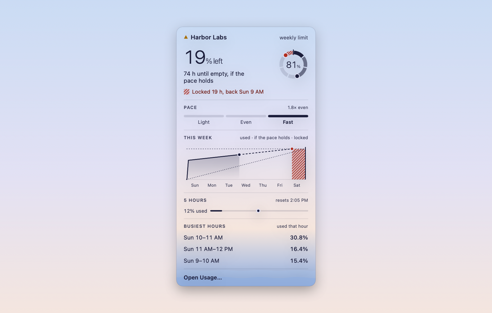
      </picture>
      <br><b>The details, one click away</b><br>
      Click a plan or a battery: what's left, when it runs out if the pace holds, how long you'd be locked out, your pace, the week as a line and your busiest hours.
    </td>
  </tr>
  <tr>
    <td width="50%" valign="top">
      <picture>
        <source media="(prefers-color-scheme: dark)" srcset="docs/images/feature-usage-dark.png">
        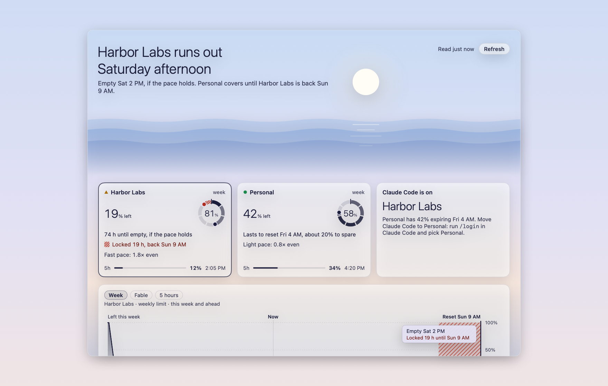
      </picture>
      <br><b>Usage, with the answer first</b><br>
      The headline says it, like <i>Harbor Labs runs out Saturday afternoon</i>. Then a card per plan, the week's chart, your pace, your busiest hours and last week.
    </td>
    <td width="50%" valign="top">
      <picture>
        <source media="(prefers-color-scheme: dark)" srcset="docs/images/feature-week-dark.png">
        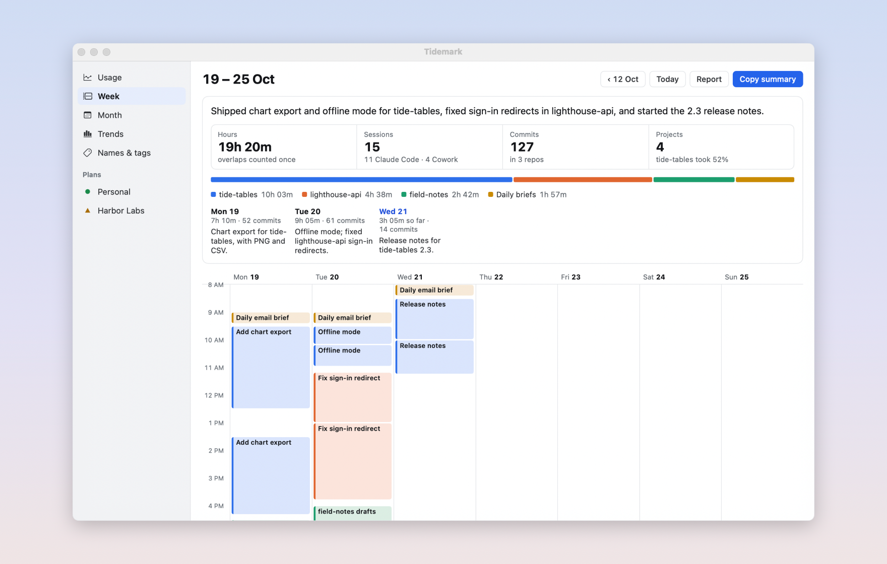
      </picture>
      <br><b>Your week as a calendar</b><br>
      Every Claude Code session and Cowork task on a calendar, with the commits each one made. Copy it as a picture for your weekly update.
    </td>
  </tr>
  <tr>
    <td width="50%" valign="top">
      <picture>
        <source media="(prefers-color-scheme: dark)" srcset="docs/images/feature-report-dark.png">
        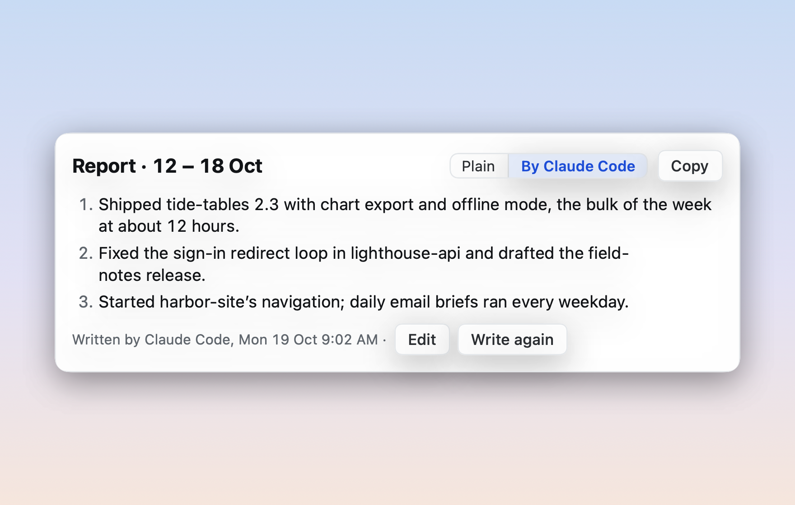
      </picture>
      <br><b>A three-line weekly report</b><br>
      Ready when you open it: plain, from your week's numbers, or written by your own Claude Code.
    </td>
    <td width="50%" valign="top">
      <picture>
        <source media="(prefers-color-scheme: dark)" srcset="docs/images/feature-trends-dark.png">
        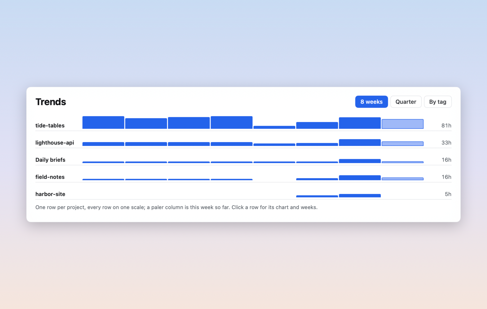
      </picture>
      <br><b>Trends, names and tags</b><br>
      Hours by project or by tag, week after week. Rename sessions and projects, tag them, and keep personal ones private.
    </td>
  </tr>
  <tr>
    <td width="50%" valign="top">
      <picture>
        <source media="(prefers-color-scheme: dark)" srcset="docs/images/feature-notch-dark.png">
        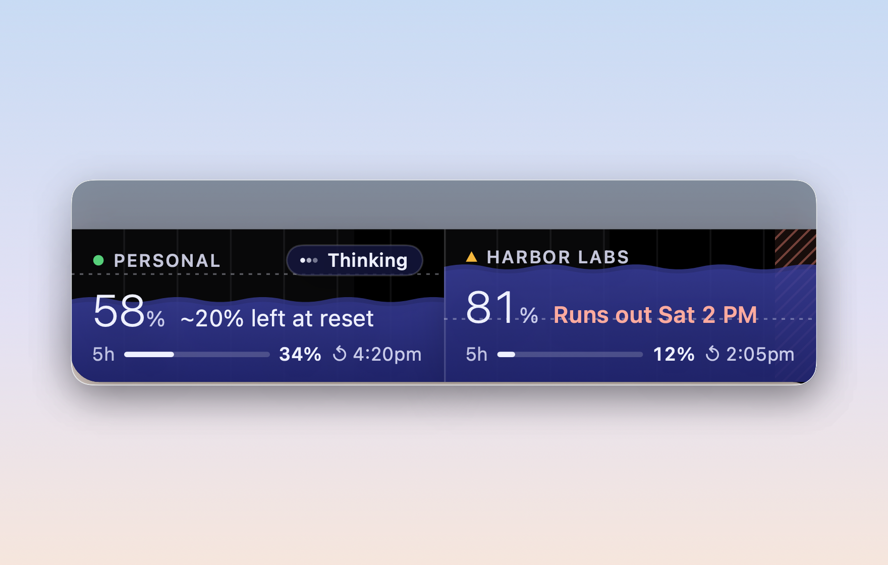
      </picture>
      <br><b>Or in the notch</b><br>
      On a MacBook with a notch, it rests as small pies beside it and opens into the same tides when you hover.
    </td>
    <td width="50%" valign="top">
      <picture>
        <source media="(prefers-color-scheme: dark)" srcset="docs/images/feature-private-dark.png">
        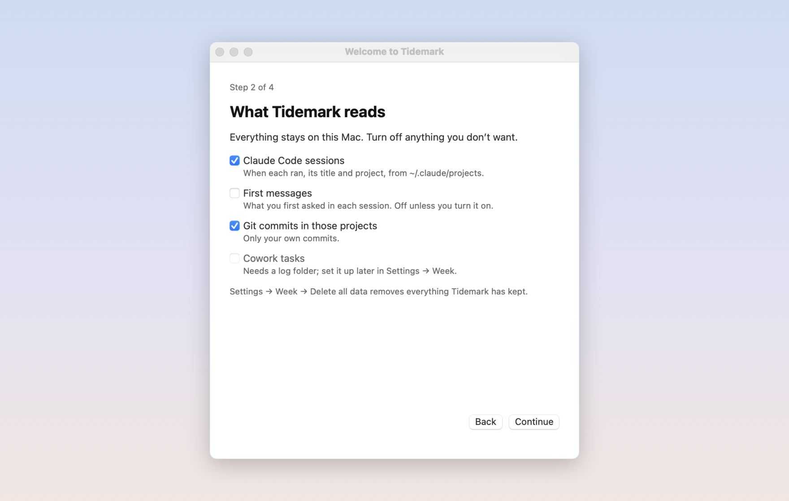
      </picture>
      <br><b>Private by design</b><br>
      You choose what it reads. No server and no analytics: your calendar stays on your Mac, and claude.ai is read only if you turn plan limits on.
    </td>
  </tr>
</table>

## See it move

<p align="center">
  
</p>
<p align="center"><sub>Claude Code's status follows your work, on the plan it's using: idle, thinking, working, needs you, done.</sub></p>

<p align="center">
  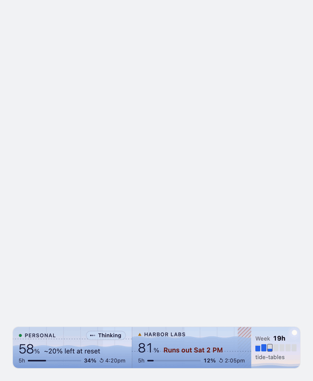
</p>
<p align="center"><sub>Click a plan for its details. Esc, or a click anywhere else, closes it.</sub></p>

## How it works

Tidemark is one small app. It reads what's already on your Mac, and claude.ai only if you ask it to. Nothing goes through us.

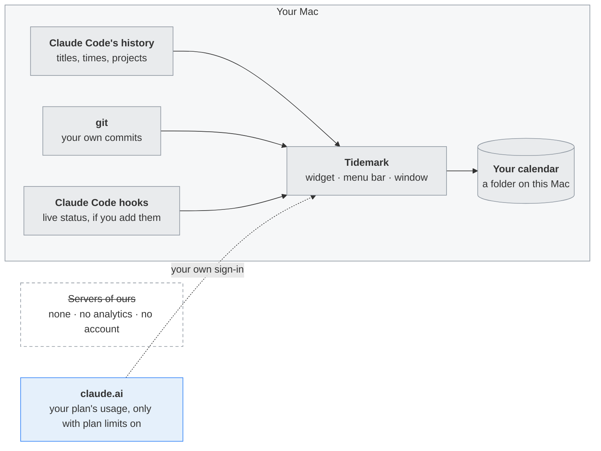

### What it reads, and when

| What | When | Why |
|---|---|---|
| Claude Code's projects folder | As files change: names and times, never what's in them | Claude Code's status |
| Each session's title, time and project | When the calendar refreshes | Your week |
| `git log` in those projects | With the calendar, your own commits only | The commits each session made |
| claude.ai's usage page | About every 3 minutes, only with plan limits on | The tides, batteries and forecasts |
| `~/.claude/settings.json` | About every 30 seconds | Whether Tidemark's hooks are in |

A new week gets 12 hours before Tidemark forecasts a run-out from it, so a fresh reset never shows red.

## Get started

1. **Download Tidemark and drag it to Applications** . From the [latest release](https://github.com/wbuf81/tidemark/releases/latest). Not an admin on this Mac? Your own Applications folder (in your home folder) works too.

   <p align="center"><picture><source media="(prefers-color-scheme: dark)" srcset="docs/images/step-download-dark.png"></picture></p>

2. **Open it. macOS says it can't check Tidemark: click Done.** Tidemark isn't signed by Apple, so macOS asks you to allow it once.

   <p align="center"><picture><source media="(prefers-color-scheme: dark)" srcset="docs/images/step-not-opened-dark.png"></picture></p>

3. **Open System Settings → Privacy & Security, scroll down and click Open Anyway.** Then Open Anyway again and your Mac's password. Only the first time.

   <p align="center"><picture><source media="(prefers-color-scheme: dark)" srcset="docs/images/step-open-anyway-dark.png"></picture></p>

4. **Choose what Tidemark reads.** Claude Code sessions and git commits, on this Mac.

   <p align="center"><picture><source media="(prefers-color-scheme: dark)" srcset="docs/images/step-reads-dark.png"></picture></p>

5. **Optional: turn on plan limits.** Sign in to claude.ai in Tidemark's window. Read the warning first.

   <p align="center"><picture><source media="(prefers-color-scheme: dark)" srcset="docs/images/step-plan-limits-dark.png"></picture></p>

6. **Find it beside your Dock and in the menu bar.** Click a plan for its details, or the widget for the window.

   <p align="center"><picture><source media="(prefers-color-scheme: dark)" srcset="docs/images/step-widget-dark.png"></picture></p>

## Questions

**Is Tidemark made by Anthropic?**
No. It's an independent app for people who use Claude Code. Claude is Anthropic's trademark.

**Is reading claude.ai allowed?**
Not officially. Anthropic hasn't approved apps reading claude.ai with your sign-in, so it's off unless you turn it on, and Anthropic could block it. Everything else works without it.

**Why does the menu bar say 42% when the widget says 58%?**
The battery shows what's left, like your Mac's battery. The tide shows how full the week is. Same plan, same reading.

**What do the red stripes mean?**
Time you'd be locked out: if you keep your current pace, the plan runs out before it resets, and the stripes are the hours from then to the reset.

**Why does macOS warn me when I first open it?**
Tidemark isn't signed by Apple (that costs $99 a year). Steps 2 and 3 above allow it once. The code is all here to read.

**Does it cost anything?**
No. It's free, and in the public domain (the Unlicense). The weekly report uses a little of your Claude plan only if you ask Claude Code to write it.

**Where does my data go?**
Nowhere. Tidemark has no server and no analytics; it keeps everything in your Library folder, and Delete all data removes it.

**Which plans work?**
Whatever claude.ai's Settings → Usage shows for your account, one tide and one battery per plan you belong to.

## Privacy

What Tidemark reads, what it keeps and where, and what the optional claude.ai reading does are all in [PRIVACY.md](PRIVACY.md). Short version: there are no analytics and no Tidemark server, and your calendar stays on your Mac. Whatever you switch off, Tidemark still watches Claude Code's projects folder for file changes (never opening the files) and reads Claude Code's settings file to see whether its hooks are there. Two things you switch on yourself send something out: reading claude.ai's usage page (plan limits), and "Write it with Claude Code", which sends the week's summary (titles, projects, hours and commit subjects; first messages only if you turned them on) to Anthropic through your own Claude Code.

## Cost

Tidemark is free. Reading Claude Code's history and git costs nothing. Only if you ask Claude Code to write the weekly report does that use a little of your Claude plan.

## Build from source

You need macOS 14 or later and Xcode 16 (or its Command Line Tools).

```sh
git clone https://github.com/wbuf81/tidemark
cd tidemark
./build.sh
```

`./test.sh` runs the tests. See [CONTRIBUTING.md](CONTRIBUTING.md) for the rest.

## Uninstall

Open Tidemark's Settings → Advanced → Uninstall…. It removes the hooks it added to Claude Code, the login item, your data and settings, then quits. The app stays in Applications: drag Tidemark to the Bin.

(Settings → Week → Delete all data is smaller: it keeps the imported copy of an old calendar and the Claude Code hooks.)

To do it by hand:

1. While Tidemark is still running, in Settings → Advanced choose Remove hooks (this removes only the entries marked `# tidemark` from Claude Code's settings). If the app is already gone, delete the lines marked `# tidemark` from `~/.claude/settings.json` yourself.
2. Quit Tidemark, then drag it from Applications to the Bin.
3. Delete `~/Library/Application Support/Tidemark`.
4. Delete the preferences: `~/Library/Preferences/io.github.wbuf81.tidemark.plist`.
5. Delete the claude.ai sign-in and caches: `~/Library/WebKit/io.github.wbuf81.tidemark`, `~/Library/HTTPStorages/io.github.wbuf81.tidemark` (and the `.binarycookies` file beside it), `~/Library/Caches/io.github.wbuf81.tidemark` and `~/Library/Saved Application State/io.github.wbuf81.tidemark.savedState`.

## License

Public domain, via the [Unlicense](LICENSE): use it, change it, sell it, no credit needed.
