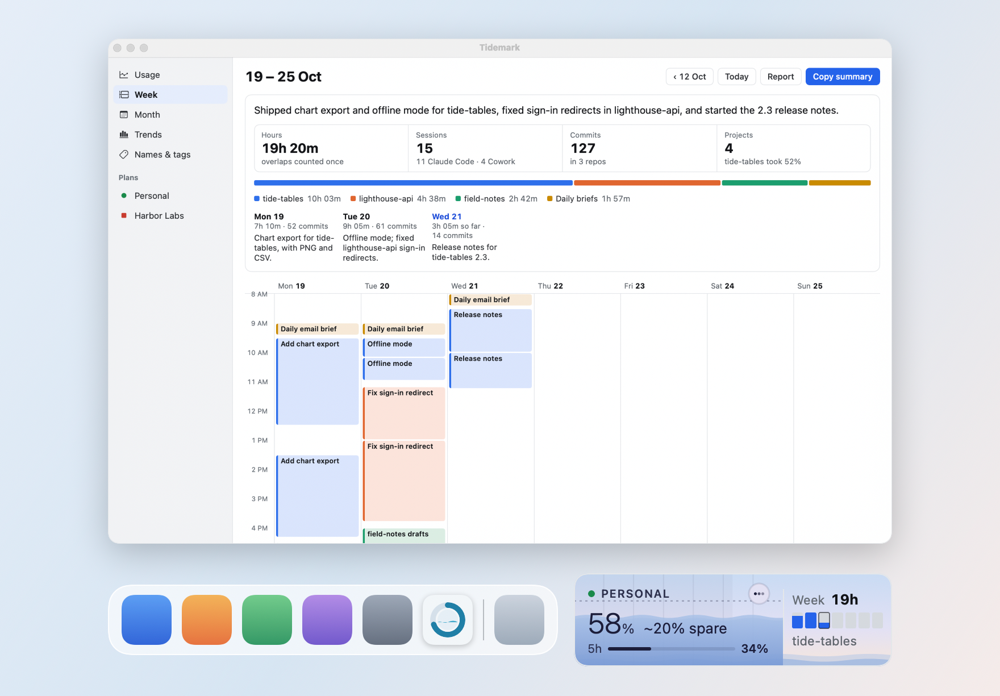
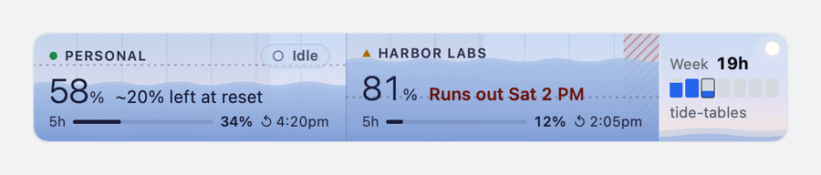
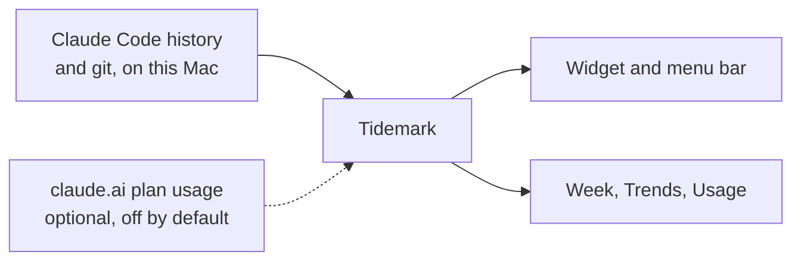
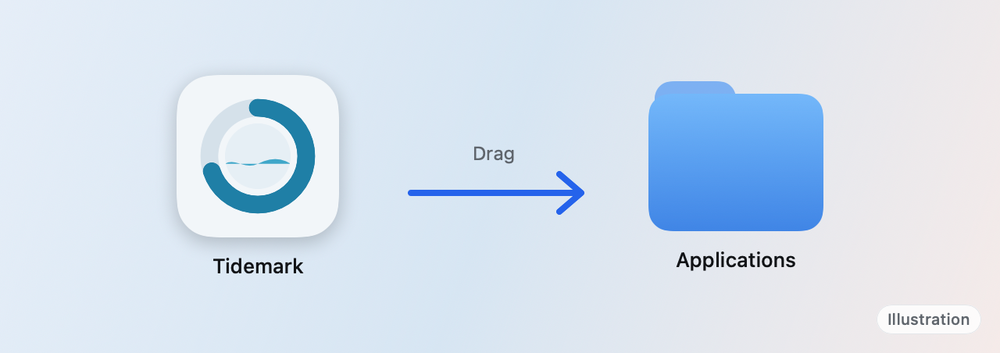
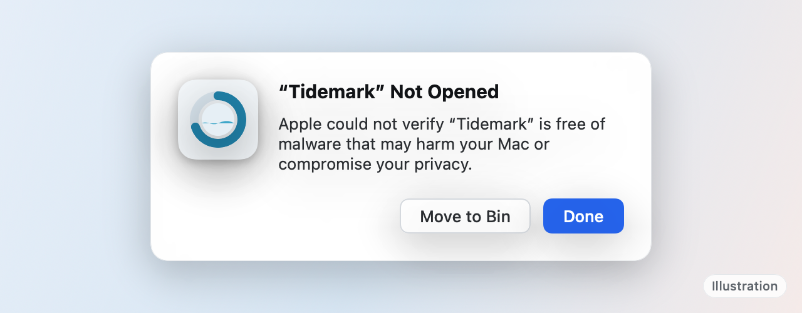
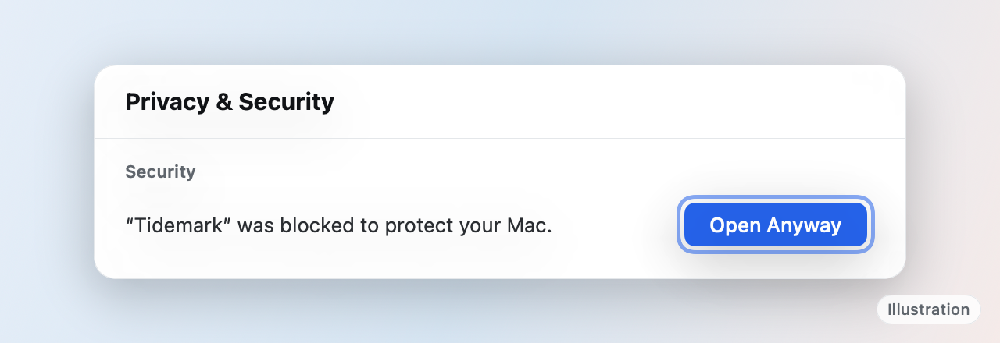
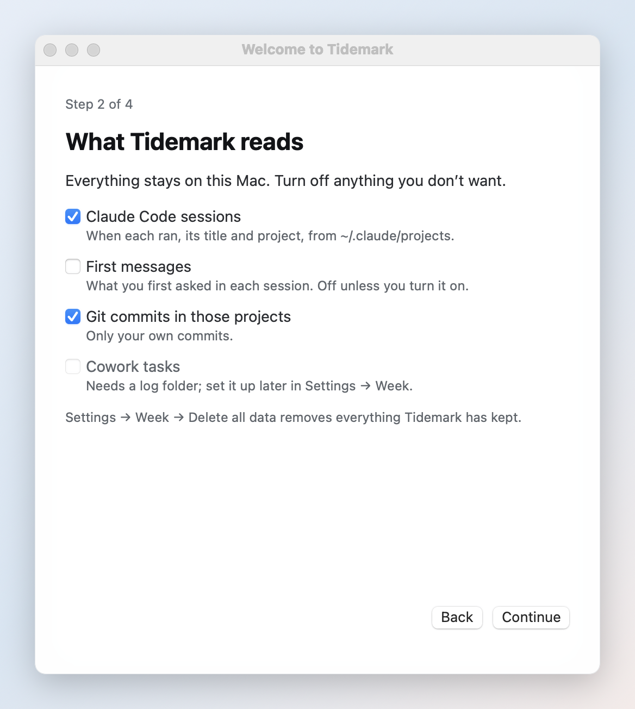
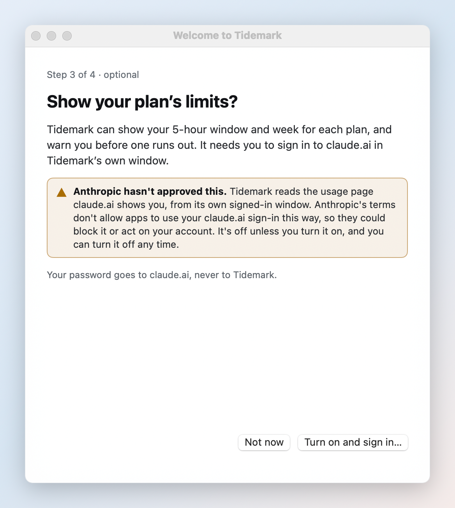
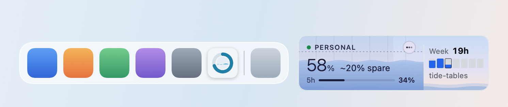

<h1 align="center">Tidemark</h1>

<p align="center">
  <b>Your week with Claude Code, and your plan's limits, at the edge of your Mac's screen.</b>
</p>

<p align="center">
  
  <a href="LICENSE"></a>
  <a href="https://github.com/wbuf81/tidemark/actions/workflows/ci.yml"></a>
</p>

<p align="center">
  <a href="https://github.com/wbuf81/tidemark/releases/latest"><b>Download for Mac</b></a>
</p>

<p align="center">
  <picture>
    <source media="(prefers-color-scheme: dark)" srcset="docs/images/hero-dark.png">
    
  </picture>
</p>

## What it does

<table>
  <tr>
    <td width="33%" valign="top"><b>Your week</b><br>Every Claude Code session on a calendar, with the commits each one made.</td>
    <td width="33%" valign="top"><b>Claude Code's status</b><br>Thinking, working, or waiting for you, beside your Dock.</td>
    <td width="33%" valign="top"><b>Trends</b><br>Hours by project and by tag, week after week.</td>
  </tr>
  <tr>
    <td valign="top"><b>Your names</b><br>Rename sessions and projects, tag them, keep personal ones private.</td>
    <td valign="top"><b>A weekly report</b><br>Three lines about your week, ready when you open the report: plain, or written by Claude Code.</td>
    <td valign="top"><b>Plan limits, optional</b><br>Each plan's 5-hour window and week, and when it runs out.</td>
  </tr>
</table>

<p align="center">
  
</p>

## How it works



## Set it up


1. **Download Tidemark and drag it to Applications.** From the [latest release](https://github.com/wbuf81/tidemark/releases/latest) on GitHub.

   <p align="center">
     <picture>
       <source media="(prefers-color-scheme: dark)" srcset="docs/images/step-download-dark.png">
       
     </picture>
   </p>

2. **Open it. macOS says it can't check Tidemark. Click Done.** Tidemark isn't signed by Apple, so macOS asks you to allow it once.

   <p align="center">
     <picture>
       <source media="(prefers-color-scheme: dark)" srcset="docs/images/step-not-opened-dark.png">
       
     </picture>
   </p>

3. **Open System Settings → Privacy & Security, scroll down and click Open Anyway.** Then Open Anyway again and your Mac's password. Only the first time.

   - macOS 15: System Settings → Privacy & Security → Open Anyway, then Open Anyway and your password.
   - macOS 14: Control-click Tidemark in Applications, choose Open, then Open. (Open Anyway in Privacy & Security is also there.)

   <p align="center">
     <picture>
       <source media="(prefers-color-scheme: dark)" srcset="docs/images/step-open-anyway-dark.png">
       
     </picture>
   </p>

4. **Choose what Tidemark reads.** Claude Code sessions and git commits, on this Mac.

   <p align="center">
     <picture>
       <source media="(prefers-color-scheme: dark)" srcset="docs/images/step-reads-dark.png">
       
     </picture>
   </p>

5. **Optional: turn on plan limits.** Sign in to claude.ai in Tidemark's window. Read the warning first.

   <p align="center">
     <picture>
       <source media="(prefers-color-scheme: dark)" srcset="docs/images/step-plan-limits-dark.png">
       
     </picture>
   </p>

6. **Find it beside your Dock and in the menu bar.** Click it for the window.

   <p align="center">
     <picture>
       <source media="(prefers-color-scheme: dark)" srcset="docs/images/step-widget-dark.png">
       
     </picture>
   </p>


## Questions

**Is Tidemark made by Anthropic?**
No. It's an independent app for people who use Claude Code. Claude is Anthropic's trademark.

**Is reading claude.ai allowed?**
Not officially. Anthropic hasn't approved apps reading claude.ai with your sign-in, so it's off unless you turn it on, and Anthropic could block it. Everything else works without it.

**Why does macOS warn me when I first open it?**
Tidemark isn't signed by Apple (that costs $99 a year). Steps 2 and 3 above allow it once. The code is all here to read.

**Does it cost anything?**
No. It's free, and in the public domain (the Unlicense). The weekly report uses a little of your Claude plan only if you ask Claude Code to write it.

**Where does my data go?**
Nowhere. Tidemark has no server and no analytics; it keeps everything in your Library folder, and Delete all data removes it.

**Which plans work?**
Whatever claude.ai's Settings → Usage shows for your account, one card per plan you belong to.

## Privacy

What Tidemark reads, what it keeps and where, and what the optional claude.ai reading does are all in [PRIVACY.md](PRIVACY.md). Short version: there are no analytics and no Tidemark server, and your calendar stays on your Mac. Whatever you switch off, Tidemark still watches Claude Code's projects folder for file changes (never opening the files) and reads Claude Code's settings file to see whether its hooks are there. Two things you switch on yourself send something out: reading claude.ai's usage page (plan limits), and "Write it with Claude Code", which sends the week's summary (titles, projects, hours and commit subjects; first messages only if you turned them on) to Anthropic through your own Claude Code.

## Cost

Tidemark is free. Reading Claude Code's history and git costs nothing. Only if you ask Claude Code to write the weekly report does that use a little of your Claude plan.

## Build from source

You need macOS 14 or later and Xcode 16 (or its Command Line Tools).

```sh
git clone https://github.com/wbuf81/tidemark
cd tidemark
./build.sh
```

`./test.sh` runs the tests. See [CONTRIBUTING.md](CONTRIBUTING.md) for the rest.

## Uninstall

Open Tidemark's Settings → Advanced → Uninstall…. It removes the hooks it added to Claude Code, the login item, your data and settings, then quits. The app stays in Applications: drag Tidemark to the Bin.

(Settings → Week → Delete all data is smaller: it keeps the imported copy of an old calendar and the Claude Code hooks.)

To do it by hand:

1. While Tidemark is still running, in Settings → Advanced choose Remove hooks (this removes only the entries marked `# tidemark` from Claude Code's settings). If the app is already gone, delete the lines marked `# tidemark` from `~/.claude/settings.json` yourself.
2. Quit Tidemark, then drag it from Applications to the Bin.
3. Delete `~/Library/Application Support/Tidemark`.
4. Delete the preferences: `~/Library/Preferences/io.github.wbuf81.tidemark.plist`.
5. Delete the claude.ai sign-in and caches: `~/Library/WebKit/io.github.wbuf81.tidemark`, `~/Library/HTTPStorages/io.github.wbuf81.tidemark` (and the `.binarycookies` file beside it), `~/Library/Caches/io.github.wbuf81.tidemark` and `~/Library/Saved Application State/io.github.wbuf81.tidemark.savedState`.

## License

Public domain, via the [Unlicense](LICENSE): use it, change it, sell it, no credit needed.
